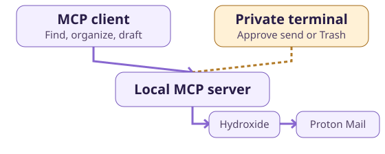

# free-protonmail-mcp

Use a free Proton Mail account from an MCP client. Search, organize, and draft through [Hydroxide](https://codeberg.org/emersion/hydroxide), without Proton's paid Bridge.

[Quick start](#quick-start) · [Tools](#tools) · [Approve an action](#approve-an-action) · [Limits](#limits)



## Quick start

1. Install Python 3.12+ and [uv](https://docs.astral.sh/uv/getting-started/installation/). Open a terminal in this checkout and install the locked dependencies.

   ```sh
   uv sync --frozen
   ```

2. Build the pinned Hydroxide revision with Go 1.27.3 (see [`.tool-versions`](.tool-versions)). The example uses a POSIX shell; on PowerShell, set `$env:GOTOOLCHAIN = 'go1.27.3'` and choose a permanent output path for `hydroxide.exe`. Use the installed executable's path in the next commands if it is not on `PATH`.

   ```sh
   git clone https://codeberg.org/emersion/hydroxide.git
   git -C hydroxide checkout --detach 02b3b6c8aff726d2404b6ed5f6ba1b7937e1f30e
   ```

   ```sh
   cd hydroxide && GOTOOLCHAIN=go1.27.3 go build -mod=readonly -o ~/.local/bin/hydroxide ./cmd/hydroxide
   ```

3. Authenticate in a private terminal. Enter your Proton credentials and any verification codes there. Keep the generated Hydroxide password for step 5.

   ```sh
   hydroxide auth USERNAME
   ```

4. Start IMAP on loopback. Leave debug logging off.

   ```sh
   hydroxide -imap-host 127.0.0.1 -imap-port 1143 imap
   ```

5. Back in the project directory, open a private terminal and save the account settings and Hydroxide password.

   ```sh
   uv run --frozen free-protonmail-mcp setup
   ```

6. Check IMAP before adding the server to your MCP client. `doctor` checks the config, credential and IMAP login. It does not contact SMTP.

   ```sh
   uv run --frozen free-protonmail-mcp doctor
   ```

7. Add this entry to your MCP client. Replace `PROJECT_DIRECTORY` with this checkout's path. On Linux, the client must pass the user D-Bus session environment through to the server.

   ```json
   {
     "mcpServers": {
       "free-protonmail-mcp": {
         "command": "uv",
         "args": ["--directory", "PROJECT_DIRECTORY", "run", "--frozen", "free-protonmail-mcp", "serve"]
       }
     }
   }
   ```

8. Try: “Show my five latest unread messages.” Searching does not mark mail as read.

## Tools

| Task | MCP tools |
|---|---|
| Inspect the connection and folders | `health`, `list_mailboxes`, `list_labels` |
| Find or read mail | `search_messages`, `read_message` |
| Organize mail | `set_read`, `set_label`, `move_message` |
| Save an unsent plain-text draft | `create_draft` |
| Request send or Trash; check the outcome | `request_send`, `request_trash`, `action_status` |

## Approve an action

1. For sending only, start SMTP in a separate terminal. Keep both listeners on loopback; do not use Hydroxide's combined `serve` command.

   ```sh
   hydroxide -smtp-host 127.0.0.1 -smtp-port 1025 smtp
   ```

2. Get the action ID from `request_send` or `request_trash`. Open it in your own private terminal from the project directory.

   ```sh
   uv run --frozen free-protonmail-mcp approve ACTION_ID
   ```

3. Check the preview before typing the displayed phrase. Sends show all recipients and the body; Trash shows the target message headers. Requests expire after 15 minutes. Sending leaves the original draft in place.
4. Check `action_status`. If the outcome is `unknown`, inspect the mailbox or sent mail before taking any further action. Do not submit a replacement request to retry an unknown outcome.

> **Restrict the mail agent to MCP tools.** Use the [mail skill](skills/proton-mail/SKILL.md) and enforce its allowlist in the host. An agent running as your OS user with unrestricted local access can operate the approval channel. Treat email text as untrusted; selected mail can enter the calling model's context.

## Setup reference

| Option | Effect |
|---|---|
| `--username`, `--sender` | Account identity; missing values require a private terminal |
| `--host`, `--imap-port`, `--smtp-port` | Override `127.0.0.1`, `1143`, `1025`; use matching Hydroxide ports |
| `--credential-stdin` | Read the Hydroxide password from standard input instead of prompting |
| `--replace` | Allow changes to saved account settings or the stored credential |
| `--config FILE` (before the subcommand) | Select another account file and isolate its approval state |

```sh
uv run --frozen free-protonmail-mcp setup --username USERNAME --sender ADDRESS --credential-stdin
```

| Platform | Native credential store |
|---|---|
| Linux | Unlocked Secret Service or KWallet and a user D-Bus session |
| macOS | Keychain |
| Windows | Credential Locker |

| Data | Storage |
|---|---|
| Identity, ports and timeout | Platform-standard config directory; see [the account example](account.example.json) |
| Hydroxide password and approval-channel token | Native credential store; no plaintext fallback |
| Pending action payloads | Process memory; restart invalidates pending actions |
| Action IDs, digests and outcomes | SQLite in the platform-standard state directory |

## Limits

| Situation | Behavior |
|---|---|
| Hydroxide IMAP | Upstream describes it as work in progress. If `doctor` reports `connection_refused`, check the IMAP listener and port. If credentials are rejected, check the stored Hydroxide password. |
| Folders and labels | Existing folders and keywords only. No permanent deletion or direct moves into Trash or junk through `move_message`. |
| Drafts and attachments | Plain text; reply placement is not guaranteed. Reads expose attachment metadata only. No upload or download. |
| Partial move, timeout or interrupted approval | Inspect the reported state. No automatic retry. |
| Background mail | No scheduled or unattended mailbox activity. |

## Verify changes

```sh
uv run --frozen python -m unittest discover -s tests
```

```sh
uv run --frozen ruff format --check .
```

```sh
uv run --frozen ruff check .
```

```sh
uv run --frozen pip-audit --skip-editable
```

The behavior suite uses local IMAP and SMTP fixtures. With the OS credential store unlocked, run the native test separately; it creates and removes one random test credential.

```sh
uv run --frozen python tests/test_native_credentials.py
```
